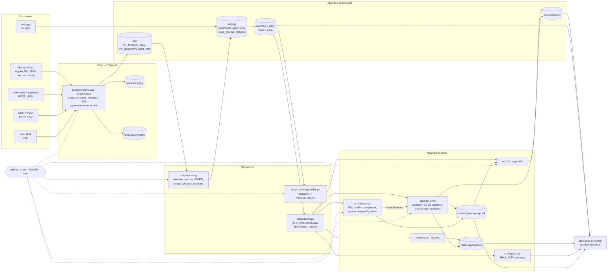
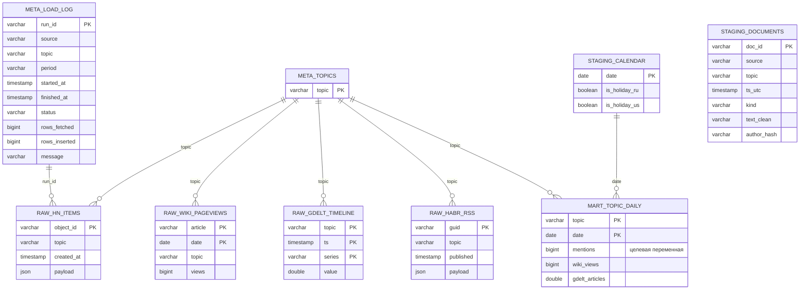

# Архитектура системы

## Потоки данных
1. **Сбор.** Коннекторы запрашивают только новые даты (водяные знаки в `meta.watermarks`), пишут в `raw` через
   `INSERT OR REPLACE` / `ON CONFLICT DO NOTHING`, каждая операция — строка в `meta.load_log`.
2. **Обработка.** `src/processing/mart.py` полностью и детерминированно пересобирает `staging` и витрину
   `mart.topic_daily`: целевая переменная, Википедия (с заменой бот-всплесков), тексты (тональность, слова-события,
   новизна), календарь.
3. **Качество.** `src/processing/quality.py` проверяет слои; критичные ошибки останавливают пайплайн до обучения.
4. **Модели.** `src/features.py` строит признаки (один код для обучения и прогноза), `src/train.py fit` отбирает
   группы признаков, сравнивает модели на CV по времени и отложенной выборке, пишет журнал и регистрирует версию.
5. **Эксплуатация.** `src/train.py predict` строит прогноз на 7 дней активной моделью, `src/monitor.py` проверяет дрейф и
   ошибку на новых фактах и по правилу запускает переобучение; реестр решает, выводить ли новую версию.
6. **Визуализация.** Дашборд читает витрину, прогнозы, журналы, реестр и считает объяснения на лету.

## Паспорта источников данных

Все источники открытые, ключи не нужны. Персональные данные не хранятся: имена авторов HN заменяются
хэшем sha256 (`author_hash`), имена авторов Habr (`dc:creator`) отбрасываются.
Проверено 16.10.2026: все источники отвечают.

**Целевая переменная:** `mentions(topic, date)` — число документов (постов и комментариев) по теме за сутки.
Считается по Hacker News — единственному источнику с глубокой историей текстов. Остальные источники дают
экзогенные признаки.

| | A. Hacker News | B. Wikimedia Pageviews | C. GDELT DOC 2.0 | D. Habr RSS | E. Календарь |
|---|---|---|---|---|---|
| Роль | цель + тексты | интерес аудитории | объём мировых новостей | русскоязычные статьи | календарные признаки |
| Тип | **слабоструктурированный** (тексты, HTML внутри) | структурированный ряд | агрегат (ряд) | **слабоструктурированный** (XML, тексты) | справочник |
| Получение | REST `hn.algolia.com/api/v1/search_by_date` | REST `wikimedia.org/api/rest_v1/metrics/pageviews/per-article/...` | REST `api.gdeltproject.org/api/v2/doc/doc?mode=timelinevolraw` | RSS `habr.com/ru/rss/hubs/<хаб>/articles/` | библиотека `holidays` |
| Формат | JSON | JSON | CSV | XML (RSS 2.0) | — |
| Гранулярность | событие (пост/комментарий) | сутки | 15 минут | событие (статья) | сутки |
| Глубина истории | с 2007 г. | с июля 2015 | ~3 месяца (скользящее окно) | последние ~40 статей, **копится с момента запуска** | любая |
| Лимиты | явных нет; 1000 результатов на запрос, поэтому окно режем по суткам | лимит высокий, но **обязателен User-Agent** с контактом | **1 запрос в 5 с**, на практике чаще отвечает 429 | явных нет | — |
| Уникальный ключ | `objectID` | `(article, date)` | `(topic, ts, series)` | `guid` | `date` |
| Поле инкремента | `created_at_i` (unix time) | `date` | `ts` | `published` / `guid` | — |
| Таблица raw | `raw.hn_items` | `raw.wiki_pageviews` | `raw.gdelt_timeline` | `raw.habr_rss` | `staging.calendar` |

Разнородность: источники различаются способом получения и форматом (JSON-API, CSV-API, RSS/XML, библиотека).
Слабоструктурированные источники — A и D.

### Особенности и ограничения
- **HN**: поиск Algolia по умолчанию допускает опечатки («llm» находил «lim»), поэтому запрос идёт с
  `typoTolerance=false`. Выборка смещена в англоязычную IT-аудиторию. Одна тема = несколько запросов
  (`hn_queries`), результаты объединяются по `objectID`.
- **Wikimedia**: ряд — это интерес читателей, а не публикации. Используется как признак (с лагом).
- **GDELT**: окно истории ограничено ~3 месяцами, поэтому для обучения непригоден, но подходит как
  признак на последних месяцах и для демонстрации. Сервис нестабилен по лимитам: часть запросов получает
  HTTP 429. Это обрабатывается (интервал растёт с каждой попыткой, ошибка пишется в `meta.load_log`,
  остальные источники продолжают работу); недогруженное добирается следующим запуском.
- **Habr**: RSS отдаёт только свежие статьи, история накапливается с момента старта регулярного запуска.
  Это ограничение будет описано в отчёте.
- Привязка документа к теме на этом этапе — по запросам из `config.yaml`; уточнение (леммы, пороги,
  эмбеддинги) запланировано на шаге обработки данных.

### Темы
Заданы в `config.yaml` (раздел `topics`): `ai_llm`, `cybersecurity`, `crypto`, `electric_vehicles`, `space`.
У каждой — запросы HN, статьи Википедии, запрос GDELT и хаб Habr. Тему можно добавить без изменения кода.

## Хранилище: слои и таблицы

Хранилище — один файл DuckDB (`data/media.duckdb`). Слои — схемы БД. Схема создаётся в `src/db.py`
командой `create ... if not exists`, повторный запуск безопасен.

| Слой | Назначение |
|---|---|
| `raw` | ответы источников без преобразований; хранит сырую информацию для пересчёта |
| `staging` | очищенные таблицы единой схемы (заполняются на шаге обработки) |
| `mart` | витрина `тема × день` для признаков и моделей |
| `meta` | журнал загрузок, водяные знаки инкрементальной загрузки, результаты проверок качества, справочник тем |

Идемпотентность: у всех таблиц заданы первичные ключи, запись — `INSERT ... ON CONFLICT DO NOTHING`,
поэтому повторная загрузка тех же данных не создаёт дублей (тест `test_incremental_load_is_idempotent`).

### Таблицы
**meta**
- `meta.topics` — справочник тем из конфига.
- `meta.load_log` — журнал: одна строка на каждую операцию загрузки (`running` → `success` / `failed`).
- `meta.watermarks` — последняя загруженная позиция по `(источник, тема)`; используется инкрементальной загрузкой (шаг 4).
- `meta.dq_results` — результаты проверок качества данных (шаг 5).

**raw**
- `raw.hn_items` — пост или комментарий HN целиком (JSON без имени автора).
- `raw.wiki_pageviews` — просмотры статьи за сутки.
- `raw.gdelt_timeline` — объём новостей по запросу с шагом 15 минут (серии `Article Count`, `Total Monitored Articles`).
- `raw.habr_rss` — запись RSS (заголовок, ссылка, аннотация, теги, дата).

**staging** *(заполняются на шагах 5–6, кроме календаря)*
- `staging.documents` — единая таблица текстов HN и Habr: время UTC, тип (`story`/`comment`/`article`), очищенный текст, домен, оценка, язык, `author_hash`.
- `staging.pageviews`, `staging.news_volume` — очищенные ряды B и C.
- `staging.calendar` — праздники RU/US по дням (2022–2027), заполняется сразу.

**mart**
- `mart.topic_daily` — витрина: `mentions` (целевая переменная), число постов и комментариев, статей Habr, просмотры Википедии, объём GDELT.
